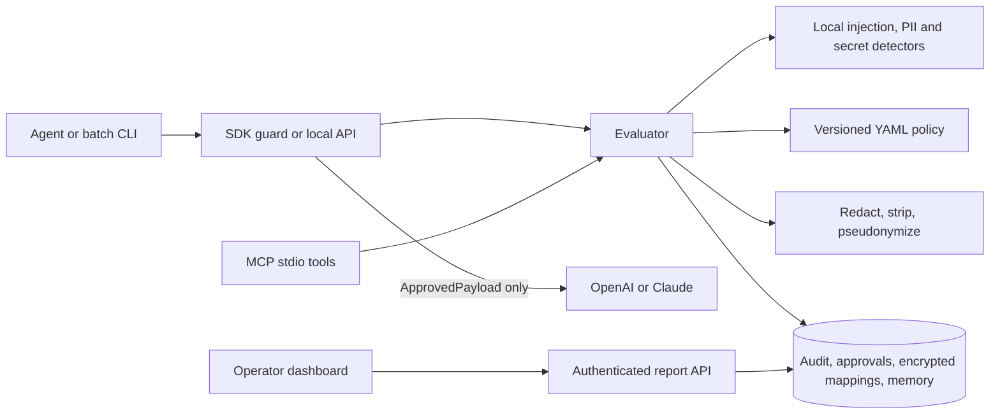

# Architecture

One modular FastAPI service handles evaluation. The SDK, MCP server, CLI, and dashboard use the same contracts through separate entry points. Storage defaults to SQLite, with Postgres supported through SQLAlchemy. Optional Redis caching holds only aggregate report data.

An evaluation carries the operation and content, source and destination, case and agent IDs, plus optional provenance and approval ID. Local detection produces separate injection and privacy scores. The evaluator then applies policy, transforms content when needed, rescans it, and records an audit event without the content. Only a successful evaluation returns an admitted payload. Errors return `block` with no payload.

High-severity prompt injection and secret findings block. Lower-risk instructions can be stripped. Internal PII is pseudonymized by case or redacted; exported/model-output PII is redacted. The mapping table stores encrypted values and keyed lookup digests. Memory stores only admitted content and enforces TTL at read. Privileged tool requests require an operator approval bound to case, operation, source, destination, agent, payload digest, and policy hash; approval is single-use.

The MCP server runs over stdio on the local machine. The CLI and Python SDK restrict ordinary HTTP calls to loopback. The dashboard calls operator-authenticated report endpoints; it does not read the database or mapping values directly. Provider adapters accept immutable `ApprovedPayload` objects from the guard.
# Action authorization and provenance

Content screening and action authorization are independent. HTTP/MCP callers
have bound identities, while a host-owned tool registry checks schemas, grants,
and targets before issuing an approved tool payload. At dispatch, the broker
re-evaluates the exact action for its bound agent and case. Only registered host
callbacks can run; model code is never evaluated.

Provenance uses a separate SQL table of opaque handles and content digests, without
raw payloads. Parent verification is bounded; references expire no later than their
parents. Exposure state persists per agent across cases to prevent lineage omission
or case switching from restoring action authority. Durable memory writes always
require operator review. Exact approval binding includes both policy hashes.

The reader extracts paragraphs into typed data in a bounded subprocess without
inherited credentials. Those strings remain untrusted: extraction provides neither
semantic sanitization nor a complete sandbox, and a privileged planner must not
interpret the strings as instructions. Optional local semantic inference adds
screening without runtime model downloads. Inference failures block requests,
while capability checks apply regardless of classifier results.

See [full integration and limits](defense-in-depth.md),
[reader process](isolated-reader.md), [local classifier](semantic-screening.md).
