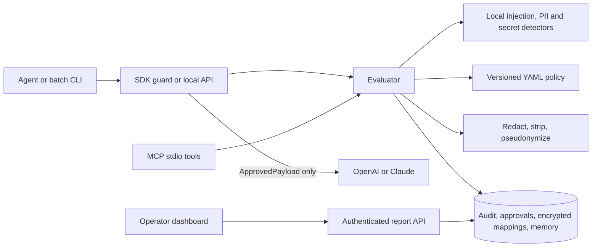

# Architecture

The pilot runs as one modular FastAPI service. The SDK, MCP server, CLI, and dashboard are separate entry points to the same contracts. SQLite is the default database; SQLAlchemy also supports Postgres. Redis is optional and caches only aggregate report data.

Every evaluation accepts an operation, content, source, destination, case ID, agent ID, optional provenance, and optional approval ID. The evaluator detects findings locally, scores injection and privacy separately, applies the active policy, transforms content where required, rescans it, then records a content-free audit event. It returns an admitted payload only after those steps succeed. All errors at this boundary return `block` with no payload.

High-severity prompt injection and secret findings block. Lower-risk instructions can be stripped. Internal PII is pseudonymized by case or redacted; exported/model-output PII is redacted. The mapping table stores encrypted values and keyed lookup digests. Memory stores only admitted content and enforces TTL at read. Privileged tool requests require an operator approval bound to case, operation, source, destination, agent, payload digest, and policy hash; approval is single-use.

The MCP server runs over stdio on the local machine. The CLI and Python SDK restrict ordinary HTTP calls to loopback. The dashboard calls operator-authenticated report endpoints; it does not read the database or mapping values directly. Provider adapters accept immutable `ApprovedPayload` objects from the guard.
# Action authorization and provenance

The evaluator combines independent content screening and action authorization.
HTTP/MCP callers have a bound agent identity. A separate host-owned tool registry
validates schemas, grants and targets before any approved tool payload is issued.
The execution broker binds a task's agent and case, re-evaluates the exact action,
and only dispatches to registered host callbacks. It does not evaluate model code.

Provenance uses a separate SQL table of opaque handles and content digests, without
raw payloads. Parent verification is bounded; references expire no later than their
parents. Exposure state persists per agent across cases to prevent lineage omission
or case switching from restoring action authority. Durable memory writes always
require operator review. Exact approval binding includes both policy hashes.

The isolated reader is a credential-separated, bounded subprocess producing typed
data. It is a paragraph extraction transport, not a semantic sanitizer or complete
sandbox. A privileged planner must not treat extracted strings as instructions.
Optional local semantic inference screens content without downloading models at
inference time. Failures block the request, and capability checks still apply.

See [full integration and limits](defense-in-depth.md),
[reader process](isolated-reader.md), [local classifier](semantic-screening.md).
